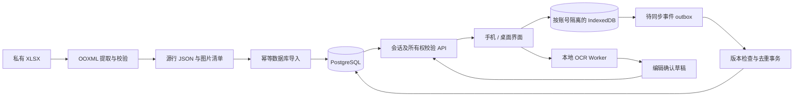

# 工程架构

采用模块清晰的 Next.js 单体、PostgreSQL 和按需运行的 Python 导入/内容批处理。当前技术版本与许可证见 `RESEARCH.md`、`THIRD_PARTY_NOTICES.md` 和锁文件。根目录 `STATUS.md` 保存实际运行状态，不以本文替代验收。

## 模块与边界

| 位置 | 职责 |
| --- | --- |
| `src/app`、`src/components` | 响应式页面、表单、学习反馈、内容详情、个人词库和 OCR 交互 |
| `src/domain/types.ts` | 客户端/服务端序列化契约 |
| `src/domain/learning.ts`、`search.ts` | 纯学习规则、FSRS 适配、错题队列、俄语检索与日历函数 |
| `src/lib/offline.ts` | 账号隔离的 Dexie 下载、会话、草稿、outbox、冲突和临时状态 |
| `src/lib/auth.ts`、`db.ts`、`config.ts` | Better Auth、Prisma/Postgres 和启动配置校验 |
| `src/server` | 所有权校验、教材/个人库 API、事件事务与内容修订 |
| `scripts/extract_vocab.py`、`import_vocab.ts` | 原工作簿提取、源图映射与数据库导入 |
| `scripts/build_annotations.py` | 有来源的代表项形态候选与注解批处理 |
| `scripts/prepare_ocr.mjs` | 固定版本 OCR worker/WASM/模型的本地准备 |

## 数据关系

`WorkbookImport` 标识文件指纹。`SourceDocument` 保存原文档身份与覆盖说明，`SourceEntry` 保留稳定来源映射，`SourceVersion` 保存各次导入原始版本；`SourceEntryLesson` 是多对多归课。`SourceAsset` 指向私有按需原图及缩略图。

`LearningItem` 是可学习内容，教材项目关联源行，个人项目关联所有者。初版不猜测词元和义项合并；注解使用带证据状态的结构化字段。`LearningCard` 按 item+direction 唯一，`UserCardState` 按 user+card 唯一。`ReviewEvent` 是留存事实，`StudySession` 保存用户归属；内容版本与用户记忆状态独立。

`Deck`、`DeckItem` 表达个人集合与引用，`ItemFlag` 表达收藏和暂停。`ContentRevision` 保存修订前后值、理由、操作者和版本。`OcrJob` 保存确认入库所对应的识别记录；未确认草稿保留在当前账号的本地空间。

## 认证与请求

Better Auth 处理真实密码和数据库会话，Next 挂载 `/api/auth/*`。业务 API 在服务端重新取得会话和当前用户，所有私有资源查询必须带所有者条件。管理员角色由服务端控制，注册请求不能自选管理员。变更请求检查 Origin 和 JSON 类型；`X-Slovo-User` 必须与当前会话匹配，防止另一标签页切换账号后把旧页面事件记到新账号。

固定测试账号只由显式 demo 配置在隔离库中 seed；正式环境与 demo 配置冲突时启动失败。账号 seed 幂等，不能用重跑 seed 清除已有进度。管理员随机密码保存于被忽略的本地访问文件。

## 离线与同步

学习题目在客户端即时判定、解释和反馈，写入成功后再前进。`commitAttempt` 用同一个 IndexedDB 事务保存答题事件和会话游标。每个事件带稳定 id、设备与递增序号、卡片、方向、作答时间、内容版本、调度参数版本和基线状态版本。

服务端以用户 advisory transaction lock 串行处理，同一 id 同内容重传只确认；同一 id 换内容拒绝。唯一设备序号保护重传。当前合法选项答案由服务端核对，客户端不能通过 `correct:true` 伪造选择题结果。正式事件更新 FSRS，短时纠错与提前曝光只记 practice。

陈旧基线、内容变更、异常时钟或未知调度版本保留为冲突，不覆盖已接受状态。响应返回权威状态或 `resetCardIds`，客户端覆盖/清除暂存预测。用户可将冲突保留为练习或放弃，均不改写长期状态。该方案选择显式版本冲突处理，不声称已实现任意跨设备历史自动合并。事件留存允许后续按固定策略重算。

服务器接收顺序与确定的设备/序号/id 次序用于活动排序；有效时间与原客户端时间分开。用户时区仅用于日统计，持久时间戳为 UTC。参考 `LEARNING_ENGINE.md`。

## PWA 与资源

应用壳可缓存，教材数据通过显式下载写入账号隔离的 IndexedDB。Service Worker 不应缓存认证、业务 API 或私有图像响应。原表图经认证读取并使用 `private, no-store`；完整 Excel 和 108 幅图像不进入首屏包。

OCR 在浏览器 worker 中运行，worker、WASM 和俄语/简体中文模型由项目托管并按需加载。图片解码、尺寸限制、取消、失败和文本编辑都是可见状态；确认前不生成正式学习项目。系统语音仅在检测到俄语 voice 时使用，实际设备可能没有可用声音。

## 运行时 AI 与后续扩展

当前核心不依赖外部 AI；界面显示云增强未配置。形态分析和代表性内容是批处理候选，不等于人工审核。`src/server/enrichment.ts` 提供服务端 provider 契约、Zod / JSON Schema、源条目与内容版本校验、超时、有限重试、调用间隔、调用次数预算、有限缓存及取消信号，单元测试验证这些边界。缓存保留原生成时间；结果不允许 `reviewed` 状态。当前没有注册云端适配器，也没有发起外部模型调用；启用具体供应商、持久作业和费用预算是后续内容补全任务。学习和正误判定不调用模型，外部文字只作为数据。

暂不增加微服务、消息中间件、向量数据库或商业同步服务。生产凭据、备份、访问域名、共享演示沙盒以及真实设备兼容分别验收，不能从本地构建成功推断上线完成。
